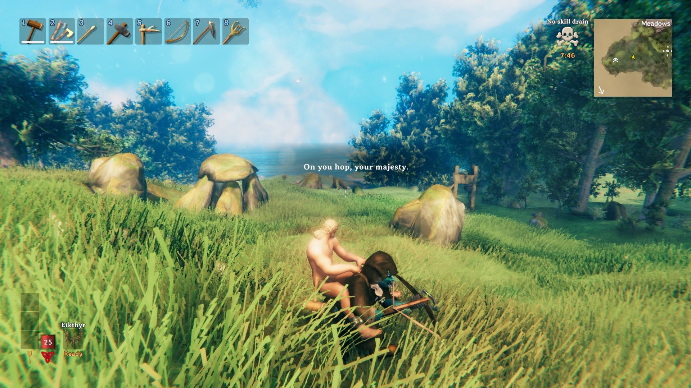

# Uter the Porter

A client-side Valheim mod: call Uter, a grumpy Dverger porter, and he'll piggyback you home or to your
gravestone, running round water and cliffs and complaining all the way.



- **Download:** [Thunderstore](https://thunderstore.io/c/valheim/p/wpkenny/Uter_the_Porter/)
- **How to use it:** see [Package/README.md](Package/README.md) (the same text as the Thunderstore page).

## Building

Needs the .NET SDK, Valheim, and a mod-manager profile with BepInEx and Jötunn installed. Edit the paths at
the top of `UterPorter.csproj` (`ValheimDir`, `ProfilesDir`, `BepInExDir`) to match your PC, then:

```
dotnet build UterPorter.csproj -c Release
```

`pack.ps1` builds and makes the Thunderstore zip in `dist\`.
